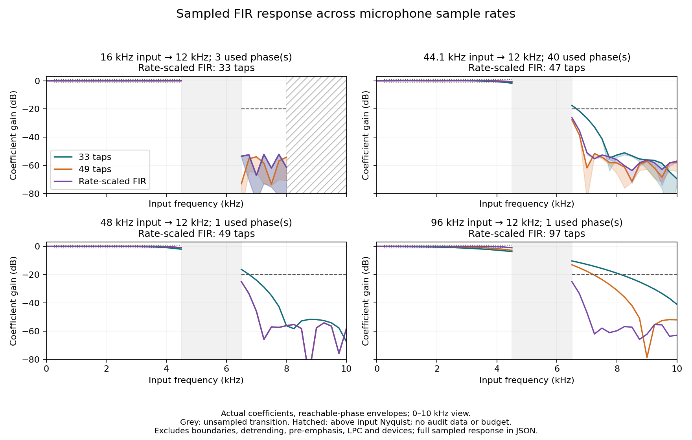

# Phase 4 rate-scaled FIR candidate — research only

2026-10-14. The candidate meets the predefined **sampled coefficient** budgets at
16/44.1/48/96-kHz input while reproducing the existing 16-kHz DEV metric summaries.
It costs more computation at high input rates. This is not independent acoustic
validation, a mobile performance result or a replacement for the classic default.

## Frozen design and source

All three measurement runs used exact clean
`adeb7b0aee37c35abdd5065a4c9bd386d9530214`. The offline variant is
`pole14_fs12000_poly_adaptive`. Its half-length is `max(16, ceil(inputRate/2000))`:
33/47/49/97 taps for the four tested rates. Half-support is at least 0.5 ms;
the 16-kHz filter retains its original longer support and coefficients.
Cutoff, 64 fractional phases, 512 samples at 12 kHz, pre-emphasis, LPC order 14,
400-Hz bandwidth limit, root solver, gates and acoustic/visual separation are
unchanged. No speaker characteristic selects the filter.

The design comes from the [fixed-filter audit](PHASE4_FIR_RESULTS.md), not final
speech labels. Both locale fixtures match the original poly33 raw/y/RMS and
formants exactly at 16 kHz. Tests verify rate switching cannot reuse a stale bank,
DC/finite/short-window behavior, actual coefficient budgets and CLI/runner dispatch.
The historical runner default set stays unchanged; new variants require a new
external output. No production HTML or shared acoustic core was changed.

## Sampled response

Same predeclared 250-Hz grid and input Nyquist endpoint: +/-1 dB at 250–4500 Hz,
gain <=-20 dB from 6500 Hz through Nyquist. Summaries use actual reachable phases;
full JSON also reports all 64 phases. No continuous-band bound is claimed.

| Input kHz | Adaptive taps | Sampled pass gain range dB | Maximum sampled stop gain dB | Both budgets pass |
| --- | ---: | --- | ---: | --- |
| 16 | 33 | -0.029 to +0.019 | -52.136 | Yes |
| 44.1 | 47 | -0.827 to +0.037 | -26.166 | Yes |
| 48 | 49 | -0.948 to +0.026 | -24.962 | Yes |
| 96 | 97 | -0.954 to +0.019 | -24.984 | Yes |



Figure-label review, 2026-10-22: the 16-kHz panel's stop-budget guide now ends
at its 8-kHz input Nyquist limit. Hatching marks the out-of-domain 8–10-kHz
area. The original figure and aggregate JSON are preserved; no measured values
or historical results were changed. See [the figure audit](../docs/FIGURE_FACT_CHECK_20261022.md).

Adaptive overlaps poly33 at 16 kHz and poly49 at 48 kHz. The figure displays
0–10 kHz only, and does not connect the unsampled transition band. The
[response aggregate](public-dataset/phase4-fir-adaptive-response.json) retains the
entire sampled range. A later plot-label correction names the changing tap count
per panel; it changes no measured data.

Boundary clamping, detrending, pre-emphasis, LPC and microphone processing are
excluded from this coefficient measurement. Increasing support changes how many
edge samples can be clamped; full-waveform and device behavior still need scrutiny.

## Actual DEV replay

Pinned Hillenbrand archive SHA-256:
`2560548591e3a726c88549b6dc9d226995616c26874d601c69fee8b9eee9d730`.
Original published references, 275 tokens /23 previously inspected DEV speakers,
all source recordings 16 kHz. Acoustic classic replay, default slider 58.
Both variants have 264 paired detections, **264 identical common-detected tokens**,
and identical recorded all/common/cohort/vowel error and uncertainty summaries:

| Variant | Paired /275 | Coverage | F1 MAE Hz | F2 MAE Hz | F2 p90 Hz | F2 errors >500 Hz |
| --- | ---: | ---: | ---: | ---: | ---: | ---: |
| Existing poly33 | 264 | 96.00% | 31.426 | 138.495 | 251.766 | 20 |
| Rate-scaled | 264 | 96.00% | 31.426 | 138.495 | 251.766 | 20 |

The earlier clean raw-classic control produced 36.830/148.904/496.750 Hz at
263/275; see [its explicit source/protocol](PHASE4_ZERO_RESULTS.md). That is
separately attributed evidence, not another baseline run inside this comparison.

Fairness limits persist: girls coverage is 43/48 (89.58%); adult-women F2 MAE
190.126 Hz and p90 526.364 Hz. A favorable aggregate does not resolve these groups.
The [DEV aggregate](public-dataset/phase4-fir-adaptive-dev.json) retains denominators,
vowel/cohort summaries and 2,000-replicate speaker-cluster intervals (seed 20261013).
DEV point estimates do not satisfy the independent final gate.

## Host analysis time and cost

Single Linux x64 /AMD EPYC 9V74 run, Node v24.19.0. Actual page `processAudio`
executed in its VM harness with stationary synthetic multitone input, classic
mode. One cold call, 20 warmups and 200 timed calls per variant/rate. Every timed
call was processed and accepted; these are synthetic workload counts, not speech
coverage. `performance.now()` measures wall-clock elapsed time, including GC and
scheduling, not process CPU accounting. Setup, real capture and actual rendering
are excluded. Percentiles use nearest rank.

| Input kHz | Existing poly33 warm p95 ms | Adaptive cold ms | Adaptive warm p95 ms | Adaptive p99 ms | Adaptive maximum ms |
| --- | ---: | ---: | ---: | ---: | ---: |
| 16 | 7.460 | 11.243 | 7.507 | 9.243 | 13.258 |
| 44.1 | 6.556 | 13.557 | 8.387 | 10.633 | 11.409 |
| 48 | 6.431 | 13.315 | 9.219 | 10.206 | 14.673 |
| 96 | 5.980 | 23.580 | 17.930 | 23.119 | 28.682 |

No timed call exceeded the 75-ms hop budget in this host run. At 96 kHz, adaptive
p95 is about three times the original: the coefficient improvement has a real
cost. Same-rate fluctuations at 16 kHz do not imply an algorithm speed change.
These numbers are not bounds, device latency or mobile feasibility evidence.
Full [host profile](public-dataset/phase4-fir-adaptive-host-profile.json) preserves
configuration, timer, cold/warm/processed counts, overruns and source digests.

## Reproduction and next gate

Use the frozen measurement source and new external outputs:

```sh
set -o noclobber
node vowelscope/validation/filter_response_audit.mjs --include-adaptive > /workspace/research-results/new-adaptive-response.json
python3 vowelscope/validation/run_phase3_poles.py \
  --archive-cache /workspace/research-cache/h95-alldata.zip \
  --out /workspace/research-results/new-adaptive-dev.json \
  --variants pole14_fs12000_poly33 pole14_fs12000_poly_adaptive
node vowelscope/validation/resampler_profile.mjs > /workspace/research-results/new-adaptive-profile.json
```

Run the host profile separately from CPU-intensive checks; even then other host
load can affect timings. Plot using the current `plot_filter_response.py` and
writable cache paths as described in the fixed-filter audit. Tests: 98 Node,
27 Python, bilingual smoke, Phase3 and eight Phase3b variants passed locally;
review corrections cover report safety, provenance and wall-clock timer naming.
No remote CI or deployment is implied.

Keep this candidate offline. Next mandatory actions are trusted blinded F1/F2
references for the private L2-ARCTIC selection and real desktop/mobile microphone
measurements. Only then can an independent comparison and a release decision be
made. Final accuracy, fairness and device gates remain unmet.
