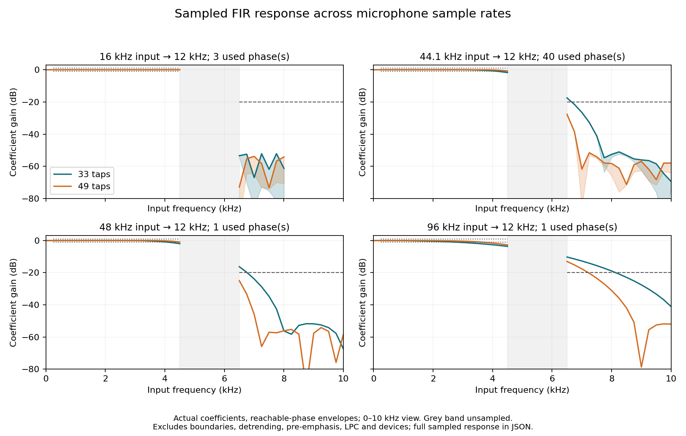

# Phase 4 multirate FIR coefficient audit

2026-10-14. Existing fixed 33-/49-tap filters do **not** meet the sampled
coefficient budgets uniformly across input sample rates. This is not a new
formant accuracy result, continuous-band certification or real-device validation.

Source: exact clean `7861e839ba72a8e028084dfb9f5fbbef64bfa301`. The audit observes
actual generated kernels and actual selected phases in the existing research
preprocessor; it does not construct a separate resampler. Analytical three-tap
response, unit DC gain of every actual phase and reachable-phase counts were
tested. 92 Node/26 Python tests passed before the source was frozen.

Predeclared sampled engineering budgets: gain within +/-1 dB at 250–4500 Hz;
maximum gain <=-20 dB from 6500 Hz to input Nyquist. Grid step 250 Hz plus the
Nyquist endpoint, including 22050 Hz at 44.1-kHz input. Summaries use phases
actually reached during 512-output-sample preprocessing: 3, 40, 1, 1 for
16/44.1/48/96 kHz. The full aggregate also distinguishes all 64 bank phases.

| Taps | Input kHz | Lowest sampled pass gain dB | Highest sampled stop gain dB | Both budgets pass |
| --- | ---: | ---: | ---: | --- |
| 33 | 16 | -0.029 | -52.136 | Yes |
| 33 | 44.1 | -1.732 | -17.451 | No |
| 33 | 48 | -1.951 | -16.271 | No |
| 33 | 96 | -3.634 | -10.268 | No |
| 49 | 16 | -0.010 | -53.826 | Yes |
| 49 | 44.1 | -0.725 | -27.671 | Yes |
| 49 | 48 | -0.948 | -24.962 | Yes |
| 49 | 96 | -2.727 | -13.026 | No |

The previously tested 1-kHz pass /8-kHz attenuation at 48-kHz input remains true,
but says little about the 4.5-kHz passband edge or 6.5-kHz alias attenuation.
At 96-kHz input, 33 taps yield approximately -18.968 dB at 8 kHz; the earlier
48-kHz two-tone test therefore cannot be generalized to all capture rates.



The figure shows only 0–10 kHz; the [aggregate JSON](public-dataset/phase4-fir-response.json)
retains the entire sampled frequency range. Lines do not bridge the unmeasured
4.5–6.5-kHz transition band. Coefficient gain excludes boundary clamping, mean
removal, pre-emphasis, LPC, microphone processing and scheduling; whole-waveform
replay can yield different attenuation. No claim about F1/F2 errors follows.

Reproduce on the source revision, preserving earlier outputs:

```sh
set -o noclobber
node vowelscope/validation/filter_response_audit.mjs > /workspace/research-results/new-fir-audit.json
MPLCONFIGDIR=/workspace/research-cache/matplotlib XDG_CACHE_HOME=/workspace/research-cache/plot-cache \
  python3 vowelscope/validation/plot_filter_response.py \
  --report /workspace/research-results/new-fir-audit.json \
  --out /workspace/research-results/new-fir-audit.png
```

Plotting uses optional matplotlib; Node auditing/tests need no new dependency.
The initial figure rendered successfully after matplotlib fell back from its
unwritable default cache to `/tmp`; the command above sets writable cache paths.
No filter settings or production defaults changed in this audit.
